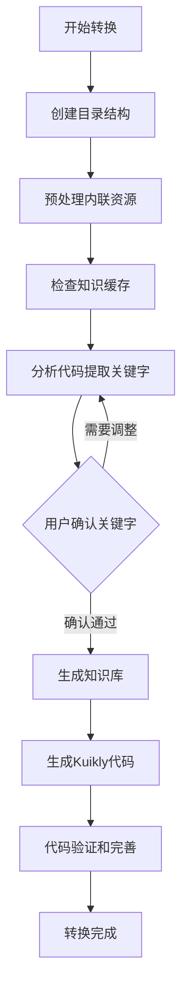

# react2kuikly — React Native 页面转 Kuikly 代码 Skill
 
## 背景

随着团队 Kuikly 动态化改造的推进，存量 React Native 页面的迁移成为一项工作量较大的任务。为了提升迁移效率，我们探索了用 AI 来辅助完成 React Native → Kuikly 的代码转换。

**第一阶段（MCP 工作流）**：在 Skill 能力尚未支持时，我们基于 MCP 搭建了一套转换工作流，对存量页面和组件进行了批量转换，

| 类型 | 数量 |
|------|------|
| React Native 页面 | 4 个 |
| H5 页面 | 5 个 |
| React Native 公共组件 | 3 个 |

转换效果良好，**代码采用率达到 90% 以上**，大幅减少了人工编写的工作量。

**第二阶段（Skill 工作流）**：Skill 能力上线后，我们将原有的 MCP 转换流程迁移并重构为 Skill 形式，同时将业务相关的规则、示例代码、Checklist 等内容单独抽离为独立的业务 Skill，形成了**核心 Skill + 业务 Skill**的组织方式，使转换工作流具备了更好的复用性和可维护性，其他业务团队也可以通过接入业务 Skill 的方式快速使用。

本文对工作流的功能特性、整体架构和接入方式做简要介绍。对于SKILL的设计选型，可以参考另一篇文章

---

## 目录

1. [功能介绍](#1-功能介绍)
2. [架构图与流程图](#2-架构图与流程图)
3. [接入指南](#3-接入指南)

---

## 1. 功能介绍

### 1.1 智能关键字提取与按需知识加载

传统方式将所有框架文档全量加载到上下文，导致 token 浪费严重。react2kuikly 采用**按需加载**策略：

- 扫描源码，精确识别用到的 Kuikly 组件和业务场景
- 只加载当前页面实际需要的组件文档和业务规则
- 基础框架知识全量加载，确保转换基础准确

### 1.2 内联资源预处理

React Native 项目中常见大量 base64 内联图片和 SVG 组件定义，这些内容在转换阶段毫无价值却占用大量 token。步骤 2 的预处理脚本：

- 自动识别并提取所有内联资源
- 替换为本地文件引用
- 支持跨目录追踪（`@/` 别名路径）
- 自动处理 SVG `color` → `tintColor` 转换

### 1.3 渐进式转换策略

采用**方案 B（先逐文件完整转换，后架构整理）**：

- 每个文件独立完整转换，LLM 专注于当前文件的业务逻辑
- 使用 `write_to_file` 直接写入，避免 `replace_in_file` 匹配失败
- 步骤 5.3 作为事后架构审查，统一修正架构偏差

相比"先骨架后填充"方案，实际 token 消耗少 10~15%，业务逻辑遗漏率更低。

### 1.4 可插拔业务 Skill 设计

核心 Skill 与业务规则完全解耦：

```
react2kuikly（核心）
    └── 调用 ──▶ biz-react2kuikly（业务 Skill）
    └── 调用 ──▶ 其他业务 Skill（可自行接入）
```

业务 Skill 通过 `PATH_CONFIG` 声明资源路径，核心脚本动态解析，无需修改核心代码即可接入新业务。

### 1.5 进度持久化与断点续传

每个页面维护独立的 `progress.md` 进度文件：

- 记录每个步骤的完成状态
- 支持跨对话恢复
- 缓存关键中间产物（关键字、知识库、分析报告），避免重复生成

### 1.6 双重质量保障

**转换时**
- 每个文件转换后立即执行单文件逻辑验证
- 立即执行业务 Checklist 检查并修正

**转换后**
- 全局逻辑功能完整性验证
- 编译检查（循环修正直到通过）

---

## 2. 架构图与流程图

### 2.1 整体架构

```
┌─────────────────────────────────────────────────────────────────────┐
│                        react2kuikly Skill                           │
│                                                                     │
│  ┌─────────────────┐    ┌──────────────────┐    ┌───────────────┐  │
│  │   业务 Skill     │    │   核心转换引擎    │    │  脚本工具集   │  │
│  │ (可插拔扩展层)   │    │  (AI Agent 驱动) │    │  (Shell/Node) │  │
│  │                 │    │                  │    │               │  │
│  │ • 业务关键字映射 │───▶│ • 关键字提取     │◀───│ • 目录初始化  │  │
│  │ • 业务转换规则   │    │ • 知识库构建     │    │ • 进度跟踪    │  │
│  │ • 代码 Checklist│    │ • 代码生成       │    │ • 缓存管理    │  │
│  │ • 示例代码       │    │ • 验证修正       │    │ • 文件分析    │  │
│  └─────────────────┘    └──────────────────┘    └───────────────┘  │
│                                  │                                  │
│                    ┌─────────────▼──────────────┐                  │
│                    │       知识库（按需构建）      │                  │
│                    │                            │                  │
│                    │  一、基础框架知识（全量）    │                  │
│                    │  二、组件知识（按需）        │                  │
│                    │  三、业务知识（按需）        │                  │
│                    │  四、架构规范（必选）        │                  │
│                    └────────────────────────────┘                  │
└─────────────────────────────────────────────────────────────────────┘
```

### 2.2 转换流程图

```
用户输入
  │  • React Native 源代码目录
  │  • 业务 Skill 名称
  │  • 目标 package
  │  • 输出目录（可选）
  ▼
┌─────────────────────────────────────────────────────────────────┐
│  步骤 1：初始化目录                                              │
│  setup-page-dirs.sh                                             │
│  创建 cache/ 目录 + 输出目录 + progress.md                      │
└──────────────────────────────┬──────────────────────────────────┘
                               ▼
┌─────────────────────────────────────────────────────────────────┐
│  步骤 2：预处理内联资源                                             │
│  extract-inline-assets.js                                       │
│  提取 base64 图片 / SVG 组件 → 本地 assets/ 文件                   │
│  替换源码中的内联引用，减少后续 token 消耗                            │
└──────────────────────────────┬──────────────────────────────────┘
                               ▼
┌─────────────────────────────────────────────────────────────────┐
│  步骤 3：检查知识缓存                                            │
│  check-cache.sh                                                 │
│  ┌─ 有缓存 ──────────────────────────────────────────────────┐  │
│  │  用户选择：使用缓存 → 跳至步骤 5                              │  │
│  │           重新生成 → 继续步骤 4                            │  │
│  └────────────────────────────────────────────────────────────┘  │
│  无缓存 → 继续步骤 4                                             │
└──────────────────────────────┬──────────────────────────────────┘
                               ▼
┌─────────────────────────────────────────────────────────────────┐
│  步骤 4：分析代码 & 构建知识库                                   │
│                                                                 │
│  4.1 收集完整源文件集合（含外部依赖追踪）                        │
│       ↓                                                         │
│  4.2 提取组件关键字（React Native → Kuikly 组件映射）                  │
│       ↓                                                         │
│  4.3 提取业务关键字（匹配业务 Skill 关键字特征）                 │
│       ↓                                                         │
│  4.4 汇总关键字 → project-keywords.md                           │
│       ↓                                                         │
│  ⏸️  用户确认关键字                                              │
│       ↓                                                         │
│  4.5 build-knowledge-cache.sh → knowledge-cache.md              │
│      （基础框架全量 + 组件按需 + 业务按需 + 架构规范必选）       │
└──────────────────────────────┬──────────────────────────────────┘
                               ▼
┌─────────────────────────────────────────────────────────────────┐
│  步骤 5：生成 Kuikly 代码                                        │
│                                                                 │
│  5.1 分析文件结构和依赖关系                                      │
│      analyze-file-structure.sh                                  │
│      → analysis-report.md + conversion-plan.md                 │
│       ↓                                                         │
│  ⏸️  用户确认转换计划                                            │
│       ↓                                                         │
│  5.2 逐文件完整转换（底层 → 中间层 → 页面层）                   │
│      每文件转换后立即执行单文件逻辑验证 + Checklist 检查         │
│       ↓                                                         │
│  5.3 架构整理与目录规范化                                        │
│      统一审查目录结构 + 修正 import 路径                         │
└──────────────────────────────┬──────────────────────────────────┘
                               ▼
┌─────────────────────────────────────────────────────────────────┐
│  步骤 6：代码验证和完善                                          │
│                                                                 │
│  6.1 逻辑功能完整性验证                                          │
│      逐文件对比源码与生成代码，检查分支/循环/状态/事件完整性            │
│       ↓                                                         │
│  6.2 编译检查                                                    │
│      analyze_files MCP 工具循环检测并修正编译错误               │
└──────────────────────────────┬──────────────────────────────────┘
                               ▼
                    ✅ 转换完成，输出 Kuikly 代码
```

### 2.3 目录结构

```
<项目根目录>/
├── react2kuikly/
│   └── [页面名称]/
│       └── cache/                         # 缓存目录（始终在项目根目录下）
│           ├── progress.md                # 进度跟踪文件
│           ├── project-keywords.md        # 关键字集合（步骤 4.4 生成）
│           ├── knowledge-cache.md         # 统一转化知识库（步骤 4.5 生成）
│           ├── analysis-report.md         # 代码分析报告（步骤 5.1 生成）
│           └── conversion-plan.md         # 转换计划（步骤 5.1 生成）
│
└── $OUTPUT_DIR/                           # 代码输出目录（由业务知识自定义，这里给的是例子）
    ├── [PageName]Pager.kt                 # 页面入口文件
    ├── composedview/                      # 组合组件目录
    ├── models/                            # 数据模型目录
    ├── viewmodel/                         # ViewModel 目录
    └── utils/                             # 工具类/常量定义

.codebuddy/skills/react2kuikly/            # Skill 本体（不需要修改）
├── SKILL.md                               # Skill 主入口
├── scripts/                               # 脚本工具集
│   ├── setup-page-dirs.sh                 # 初始化目录
│   ├── extract-inline-assets.js           # 提取内联资源
│   ├── check-cache.sh                     # 检查知识缓存
│   ├── check-progress.sh                  # 检查转换进度
│   ├── update-progress.sh                 # 更新转换进度
│   ├── analyze-file-structure.sh          # 分析文件结构
│   └── build-knowledge-cache.sh           # 构建知识库
└── references/                            # 参考文档
    ├── docs/                              # Kuikly 框架知识文档
    │   ├── dev.txt                        # 基础框架知识（全量加载）
    │   ├── view.txt / text.txt / ...      # 各组件知识（按需加载）
    │   └── ...
    ├── preprocess-inline-assets.md        # 步骤 2 详细流程
    ├── analyze-keywords.md                # 步骤 4 详细流程
    ├── kuikly-comp-keywords.md            # 组件关键字获取指引
    ├── react2kuikly-generate.md           # 步骤 5 详细流程
    └── verify-and-refine.md              # 步骤 6 详细流程
```

---

## 3. 接入指南

### 3.1 前置要求

| 要求 | 说明 |
|------|------|
| AI Agent | 支持 Skill 的 AI 编程助手环境 |
| Node.js | 用于运行 `extract-inline-assets.js` 脚本 |
| 业务 Skill | 必须有对应的业务 Skill（见 3.3） |

### 3.2 `react2kuikly` 与 `react2kuikly-config-skill` 的关系

`react2kuikly/` 是主 Skill，负责通用转码流程；`react2kuikly-config-skill/` 是业务 Skill 模板，负责提供项目规则、关键字、Checklist 和示例代码。模板不会独立转码，也不会在未指定业务 Skill 时被自动读取。

推荐使用脚手架从模板生成项目业务 Skill：

```bash
bash react2kuikly/scripts/scaffold-business-skill.sh --project myproject
# 生成 myproject-react2kuikly/
```

手动方式也可以：

```bash
cp -R react2kuikly-config-skill myproject-react2kuikly
```

补全 `myproject-react2kuikly/references/` 后，在对话中说明“业务 Skill 为 `myproject-react2kuikly`”，或让步骤 0 扫描同级目录后确认使用它。随后主 Skill 会通过 `build-knowledge-cache.sh --businessSkill myproject-react2kuikly` 读取其 `PATH_CONFIG`。

### 3.3 创建业务 Skill

业务 Skill 是 react2kuikly 的必要扩展，提供业务特定的转换规则。

#### 目录结构

```
.codebuddy/skills/[your-business-skill]/
├── SKILL.md                              # Skill 主文件（必须包含 PATH_CONFIG）
└── references/
    ├── kuikly-example-code.md            # 示例代码（必选）
    ├── checklist.md                      # 代码 Checklist（必选）
    ├── react-business-keywords.md        # 业务关键字映射（必选）
    └── react2kuikly-rules/               # 业务规则目录（必选）
        ├── 登录相关.md
        ├── 版本判断.md
        └── ...
```

#### SKILL.md 必须包含 PATH_CONFIG

在业务 Skill 的 `SKILL.md` 中，**必须**声明 `PATH_CONFIG` 配置块，供核心脚本动态解析路径：

```markdown
<!-- PATH_CONFIG_START -->
```
EXAMPLE_CODE=references/kuikly-example-code.md
CHECKLIST=references/checklist.md
BIZ_KEYWORDS_MAP=references/react-business-keywords.md
BIZ_RULES_DIR=references/react2kuikly-rules
```
<!-- PATH_CONFIG_END -->
```

> 文件名和目录名可以自定义，只需在 PATH_CONFIG 中正确声明即可。

#### 可选配置项

| 配置项 | 说明 |
|--------|------|
| `EXAMPLE_CODE` | ✅ 必选，Kuikly 页面示例代码文件路径 |
| `CHECKLIST` | ✅ 必选，代码检查规则文件路径 |
| `BIZ_KEYWORDS_MAP` | ✅ 必选，业务关键字与代码特征的映射文件路径 |
| `BIZ_RULES_DIR` | ✅ 必选，业务规则文档目录路径 |
| `BIZ_BASE_RULES` | ❌ 可选，通用基础业务规则文件路径（无需关键字匹配，全量加载） |

#### BIZ_KEYWORDS_MAP 与 BIZ_RULES_DIR 的关系

两者配合实现"按需加载业务规则"：**`BIZ_KEYWORDS_MAP` 定义"如何识别业务"，`BIZ_RULES_DIR` 存放"识别到后加载什么规则"**，关键字名称是两者的纽带。

> 举例：`BIZ_KEYWORDS_MAP` 中定义了关键字 `登录相关`，Agent 扫描源码命中该业务关键字后，就去 `BIZ_RULES_DIR/登录相关.md` 加载对应的转换规则。**规则文件名必须与关键字名称完全一致。**

**BIZ_KEYWORDS_MAP 文件格式**（定义关键字 + 识别特征）：

```markdown
# 业务关键字映射

## 登录相关
**react native代码特征**：
...

## 版本判断
**react native代码特征**：

```
给一个我们业务的例子

**BIZ_RULES_DIR 目录结构**（规则文件名必须与关键字标题一致）：

```
react2kuikly-rules/
├── 登录相关.md        ← 对应 BIZ_KEYWORDS_MAP 中的 "## 登录相关"
├── 版本判断.md        ← 对应 BIZ_KEYWORDS_MAP 中的 "## 版本判断"
└── 基础业务逻辑.md    ← 对应 BIZ_KEYWORDS_MAP 中的 "## 基础业务逻辑"
```

**单个规则文件**（`BIZ_RULES_DIR/{关键字}.md`）：
```markdown
# 登录相关
## react native实现


## kuikly实现

```

#### 示例代码文件（EXAMPLE_CODE）

提供完整的 Kuikly 页面示例，如包含：
- 页面入口（Pager）的标准写法
- ViewModel 的标准写法
- 组合组件的标准写法
- 目录结构规范

#### Checklist 文件（CHECKLIST）

列出代码生成后必须检查的规则，可以持续补充放入AI常犯的错误

```markdown
# 代码 Checklist

## 布局规则
- [ ] Text 组件内边距使用 `marginLeft` 而非 `paddingLeft`
- [ ] 图片组件必须指定 width 和 height

## 事件规则
- [ ] 页面销毁时必须取消所有事件监听（调用 off）
- [ ] 生命周期方法 onShow/onHide 必须调用 super
```

### 3.4 使用方式

#### 基本用法

在 AI 对话框中输入：

```
请将 [React Native源代码目录] 下的代码根据 react2kuikly skill 转化为 Kuikly 代码，
业务 Skill 为 [业务Skill名称]，
目标 package 为 [目标package]，
输出到 [输出目录]
```

#### 完整示例

```
请将 src/pages/visitors 下的代码根据 react2kuikly skill 转化为 Kuikly 代码，
业务 Skill 为 biz-react2kuikly，
目标 package 为 com.example.business.bizkuikly.pages.feat.visitors，
输出到 /path/to/project/src/commonMain/kotlin/com/example/business/bizkuikly/pages/feat/visitors
```

#### 必填参数

| 参数 | 说明 | 示例 |
|------|------|------|
| React Native 源代码目录 | 待转换的 React Native 页面代码所在目录 | `src/pages/visitors` |
| 业务 Skill 名称 | 对应的业务 Skill 目录名 | `biz-react2kuikly` |
| 目标 package | 生成的 Kotlin 代码的 package 声明 | `com.example.pages.home` |

#### 可选参数

| 参数 | 说明 | 默认值 |
|------|------|--------|
| 输出目录 | Kuikly 代码的输出路径 | `react2kuikly/[页面名]/working` |


# React Native转Kuikly综合技术文档

## 📋 概述

react2kuikly是一个将React Native页面代码转换为Kuikly（Kotlin跨平台框架）页面代码的完整AI工作流。该SKILL采用分步骤渐进式转换策略，确保转换过程的准确性、可控性和可恢复性。

## 🔄 整体流程图

## 过程目录结构
```
项目根目录/
├── react2kuikly/
│   └── [页面名称]/
│       └── cache/                    # 缓存目录
│           ├── progress.md           # 进度跟踪文件
│           ├── project-keywords.md   # 关键字集合
│           ├── knowledge-cache.md    # 统一知识库
│           ├── analysis-report.md    # 代码分析报告
│           └── conversion-plan.md    # 转换计划
└── $OUTPUT_DIR/                      # 代码输出目录
    ├── [PageName]Pager.kt           # 页面入口文件
    ├── composedview/                 # 组合组件目录
    ├── models/                       # 数据模型目录
    ├── viewmodel/                    # ViewModel目录
    └── utils/                        # 工具类目录
```

---

# 技术选型与架构设计

## 1. 知识来源技术选型

### 1.1 背景
在React Native页面代码转换为Kuikly页面代码的流程中，代码生成需读取大量知识文件（框架知识、组件知识、业务知识），本章对比3种知识来源方案。

### 1.2 候选方案对比

#### 方案①：kuikly-ui-framework原版文档
- **数据规模**: SKILL.md（49.36KB，~12300Token）+ 35+组件文档（237KB，~59200Token）+ 10个模块文档（23KB，~5750Token），框架文档合计约900KB（~225000Token）
- **单文件转换Token消耗**: ~37700Token
- **优点**: 信息完整性100%，包含所有API签名、参数说明、示例代码
- **缺点**: Token消耗极高，信息密度低，加载效率低
- **结论**: ❌ 不采用（Token消耗过高，不符合成本控制需求）

#### 方案②：MCP知识库检索
- **单文件转换Token消耗**: ~2500-10000Token（3-5次检索，每次返回500-2000Token）
- **优点**: Token消耗低，仅返回所需知识片段，无冗余
- **缺点**: 检索可能遗漏关键细节导致AI幻觉，存在网络延迟累积，返回结果不可控
- **结论**: ❌ 暂不采用

#### 方案③：本地精简docs（✅ 已采用）
- **数据规模**: 41个精简文档文件，总大小约85.3KB（实际字符数约85,300），总Token约21,325Token
- **单文件转换Token消耗**: 平均~520Token（按需读取，无SKILL.md注入），仅为方案①的1/72
- **优点**: Token消耗极低，信息密度极高
- **缺点**: 知识覆盖率约98%（极少数冷门API未收录），需手动同步上游框架更新
- **结论**: ✅ 已采用（可用方案中Token效率最优，适配react2kuikly转换场景）

### 1.3 三方案综合对比

| 维度 | 方案① | 方案② | 方案③ |
|------|-------|-------|-------|
| Token消耗 | 高 | 低 | 极低 |
| 知识覆盖率 | 100% | ~85% | ~98% |
| 可用性 | 引入kuikly-ui-framework skill | 需配置MCP | 立即可用 |

**Token消耗对比（单文件转换）**:
- 方案①：~37700Token
- 方案②：~6000Token（预估）
- 方案③：~520Token（平均）

方案③相比方案①节省约98.6%Token，相比方案②节省约91.3%Token。

## 2. 代码生成步骤技术方案对比

### 2.1 一次性全量生成 vs 分步骤渐进式生成

#### 方案A：一次性全量生成
- **核心思想**: 将知识库和全部React Native源代码一起交给AI，一次性生成所有Kuikly文件
- **优点**: 流程极简，开发成本低，理论上下文完整
- **缺点**: 上下文窗口硬限制，注意力衰减，可控性为零，错误恢复代价极高

#### 方案B：分步骤渐进式生成（✅ 最终采用）
- **核心思想**: 先分析结构（5.1），再逐文件转换（5.2），最后架构整理（5.3）
- **优点**: Token消耗可控，业务逻辑准确，工具调用稳定，错误恢复成本低

### 2.2 核心维度对比分析

| 维度 | 方案A（一次性） | 方案B（分步骤） |
|------|-----------------|-----------------|
| 上下文安全性 | ❌ 经常超限 | ✅ 始终在安全区间 |
| 生成准确度 | ⚠️ 40%-70% | ✅ 90%-98% |
| 可控性 | ❌ 黑盒 | ✅ 全过程可干预 |
| 错误恢复 | ❌ 全量重做 | ✅ 单文件重做 |
| 进度持久化 | ❌ 不支持 | ✅ progress.md增量恢复 |
| 用户体验 | ❌ 长时间等待 | ✅ 渐进式输出 |

### 2.3 分步骤方案的设计优势

#### 三步骤职责分工
| 步骤 | 职责 | 核心价值 |
|------|------|---------|
| **5.1 分析结构** | 理清"有什么文件、怎么依赖、先转哪个" | 避免盲目转换，确保依赖顺序正确 |
| **5.2 逐文件转换** | 专注单文件的"完整转换 + 即时验证" | 每个文件在AI的"注意力焦点"内，逻辑精确度最高 |
| **5.3 架构整理** | 统一审查"目录结构和引用关系" | 兜底检查，确保整体一致性 |

### 2.4 综合评分
| 评估维度 | 方案A | 方案B |
|---------|-------|-------|
| Token消耗 | ★★☆ | ★★★ |
| 工具调用 | ★★☆ | ★★★ |
| 架构一致性 | ★★★ | ★★☆ |
| 业务逻辑准确性 | ★★☆ | ★★★ |
| 骨架-实现匹配 | ★☆☆ | ★★★ |
| 工具稳定性 | ★☆☆ | ★★★ |
| **综合得分** | **14/21** | **19/21** |

## 3. 进度记录与关键节点存档询问设计

### 3.1 核心问题：AI Agent对话的"失忆"和"失控"
- **流程长**: 6个主步骤 + 10+子步骤，单次完整执行token消耗大
- **对话中断导致进度丢失**: Agent的上下文窗口有限，长流程中对话可能因token超限被截断
- **自动化流程缺乏人工把控点**: 流程涉及多个决策点，错误会被层层传递和放大

### 3.2 设计方案
采用**进度记录系统**和**关键节点存档询问机制**两套互机制。

#### 进度记录系统
每个页面转换任务有一个独立的进度文件`react2kuikly/[页面名]/cache/progress.md`，支持**两级粒度**:

| 粒度 | 记录内容 | 适用场景 |
|------|---------|----------|
| **步骤级** | 当前完成到哪个步骤（如5.1、5.2） | 步骤间的中断恢复 |
| **文件级** | 步骤5.2中每个文件的转换完成状态 | 逐文件转换过程中的中断恢复 |

#### 关键节点存档询问机制

**阻塞询问点**（必须等待用户确认）:
| 节点 | 位置 | 设计目的 |
|------|------|---------|
| **前置校验** | 流程开始前 | 检查业务Skill和目标package是否齐全，缺少则停止 |
| **关键字确认** | 步骤4.5 | 关键字决定知识库内容，错误关键字→错误知识→错误代码，此处纠错成本最低 |
| **转换计划确认** | 步骤5.1完成后 | 文件拆分和转换顺序直接影响代码质量，用户可判断架构合理性 |

**非阻塞缓存复用点**（提示用户选择跳过或重新生成）:
| 节点 | 缓存文件 | 行为 |
|------|---------|------|
| **知识缓存检查** | `knowledge-cache.md` | 存在→可跳到步骤5；不存在→继续步骤4 |
| **关键字缓存检查** | `project-keywords.md` | 存在→可跳过4.1~4.3直接到4.4 |
| **依赖关系和生成计划缓存** | `analysis-report.md` + `conversion-plan.md` | 存在→可直接跳到5.2 |

## 4. 业务Skill插拔式设计

### 4.1 设计背景
**核心矛盾**: 通用能力 vs 业务差异
- **框架层（通用）**: 所有项目共享的组件映射、样式转换、代码生成流程
- **业务层（差异）**: 每个项目独有的业务逻辑、组件封装、API调用、代码风格

### 4.2 设计思路
采用**"主从分离、接口约定、动态发现"**的插拔式架构：
- **主Skill（react2kuikly）**: 包含转换工作流、脚本工具集、框架转换知识
- **业务Skill（如biz-react2kuikly）**: 包含PATH_CONFIG路径声明、业务关键字映射、业务转换规则、代码Checklist、参考示例代码

### 4.3 核心机制：PATH_CONFIG协议
PATH_CONFIG是主Skill与业务Skill之间的"契约"，嵌入在业务Skill的`SKILL.md`中：

```
<!-- PATH_CONFIG_START -->
EXAMPLE_CODE=references/kuikly-example-code.md
CHECKLIST=references/checklist.md
BIZ_KEYWORDS_MAP=references/react-business-keywords.md
BIZ_RULES_DIR=references/react2kuikly-rules
BIZ_BASE_RULES=references/react2kuikly-rules/基础业务逻辑.md
<!-- PATH_CONFIG_END -->
```

### 4.4 业务Skill的4项标准能力
| 能力 | 配置项 | 用途 | 使用时机 |
|------|--------|------|----------|
| **业务关键字映射** | `BIZ_KEYWORDS_MAP` | 识别页面涉及哪些业务模块 | 步骤4.3：扫描源码匹配关键字 |
| **业务转换规则** | `BIZ_RULES_DIR` + `BIZ_BASE_RULES` | 指导具体业务逻辑转化 | 步骤4.5：按需合并到知识库 |
| **代码Checklist** | `CHECKLIST` | 生成后的规则检查清单 | 步骤5.2：逐文件检查修正 |
| **参考示例代码** | `EXAMPLE_CODE` | 指导代码架构和风格 | 步骤5.1/5.2：代码生成 |

---

## 🔧 技术架构特点

### 1. 知识来源优化
采用**本地精简docs**方案，相比原版文档节省98.6% token消耗

### 2. 进度记录系统
支持**步骤级**和**文件级**断点续传，确保长流程的可靠性

### 3. 业务Skill插拔式设计
主Skill与业务Skill分离，支持多项目动态接入

### 4. 关键节点询问机制
设置3个阻塞询问点，确保转换方向正确

## 📈 性能优势对比

| 维度 | 一次性全量生成 | 分步骤渐进式生成 |
|------|---------------|------------------|
| Token消耗 | ~37,700 | ~520（平均） |
| 生成准确度 | 40%-70% | 90%-98% |
| 错误恢复成本 | 100%重做 | 单文件重做 |
| 可控性 | 黑盒操作 | 全过程可干预 |

## 🎯 适用场景

- **复杂业务页面**: 文件数多、业务逻辑复杂
- **生产级代码**: 要求可编译运行的高质量代码
- **团队协作**: 多项目并行转换需求
- **长流程可靠性**: 需要断点续传和进度跟踪

## 📝 使用示例

```bash
# 完整转换命令示例
请将 src/visitors下的代码 根据react2kuikly skill转化为 Kuikly 代码，
业务 Skill 为 biz-react2kuikly，
目标 package 为 package com.example.business.bizkuikly.pages.feat.visitors，
输出到 /path/to/project/bizkuikly/kuikly_biz/src/commonMain/kotlin/com/example/business/bizkuikly/pages/feat/visitors
```

## 🔄 恢复执行机制

当对话中断后，可通过以下命令恢复执行：
```bash
bash scripts/check-progress.sh --pageName "页面名称" --outputDir "输出目录"
```

系统会自动读取progress.md文件，从上次中断的步骤继续执行。

---

**文档版本**: v1.0  
**最后更新**: 2026-02-27  
**维护者**: react2kuikly开发团队
