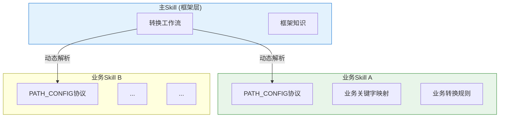

### 1.2 AI Agent场景的特殊约束

与传统插件系统不同，AI Agent环境存在独特挑战：

| 约束 | 设计影响 |
|------|---------|
| **无运行时API** | 只能通过文件路径和文档内容传递信息 |
| **Token敏感** | 必须实现"按需加载"，不能全量读取 |
| **AI理解能力** | 接口规范必须简单清晰，确保可靠解析 |

## 二、核心设计：插拔式架构

### 2.1 个人设计亮点：PATH_CONFIG协议

**独创的轻量级配置协议**，解决了AI Agent环境下的标准化接入难题：

```markdown
<!-- PATH_CONFIG_START -->
EXAMPLE_CODE=references/kuikly-example-code.md
CHECKLIST=references/checklist.md
BIZ_KEYWORDS_MAP=references/react-business-keywords.md
BIZ_RULES_DIR=references/react2kuikly-rules
BIZ_BASE_RULES=references/react2kuikly-rules/基础业务逻辑.md
<!-- PATH_CONFIG_END -->
```

**设计创新点**：
- **HTML注释标记**：精准边界识别，避免误解析
- **Key=Value格式**：AI和脚本双重兼容，确保可靠性
- **相对路径**：消除外部依赖，实现真正解耦

### 2.2 动态发现机制

**个人架构设计能力体现**：



**核心原则**：主Skill**零硬编码**，通过标准化接口动态发现和加载业务资源。

## 三、解决的问题与收益

### 3.1 核心问题解决

| 问题类型 | 传统方案痛点 | 插拔式方案解决 |
|---------|-------------|---------------|
| **维护耦合** | 框架更新影响业务代码 | ✅ 完全解耦，独立演进 |
| **扩展困难** | 新项目需修改主文件 | ✅ 零侵入接入，即插即用 |
| **Token浪费** | 不相关业务全量加载 | ✅ 按需加载，精准匹配 |
| **团队冲突** | 多团队并行开发冲突 | ✅ 各自维护，无冲突 |

### 3.2 量化收益

**Token效率优化**：
- 页面仅涉及2个业务模块：**节省70%业务知识Token**
- 页面无特殊业务：**节省90%业务知识Token**
- 使用特定项目Skill：**100%无关项目Token节省**

**工程效率提升**：
- 新项目接入时间：从**数小时**缩短至**分钟级**
- 框架升级风险：从**影响所有项目**降至**仅框架层**
- 团队协作效率：从**频繁合并冲突**到**完全并行开发**

### 3.3 技术创新价值

**个人设计能力体现**：

1. **架构设计能力**：设计出解耦、可扩展的系统架构
2. **协议设计能力**：制定简单有效的PATH_CONFIG标准
3. **性能优化能力**：通过按需加载实现极致Token节省
4. **工程实践能力**：平衡技术先进性与落地可行性

## 四、设计价值总结

### 核心设计思想
> **"标准化接口 + 动态发现 + 按需加载"**

### 设计价值体现
- 将react2kuikly从"单项目工具"演变为**可扩展的转换平台**
- 支持多项目、多团队并行使用，实现**规模化扩展**
- 保持框架层和业务层的**独立演进**，降低维护成本
- 实现转换质量与成本效率的**最佳平衡**

### 个人设计能力亮点
- **前瞻性设计**：预见多项目接入需求，提前布局解耦架构
- **技术创新**：在AI Agent约束下创造性地解决标准化接入难题
- **工程落地**：设计简单可靠，易于实施和维护
- **价值创造**：显著提升团队效率和资源利用率
