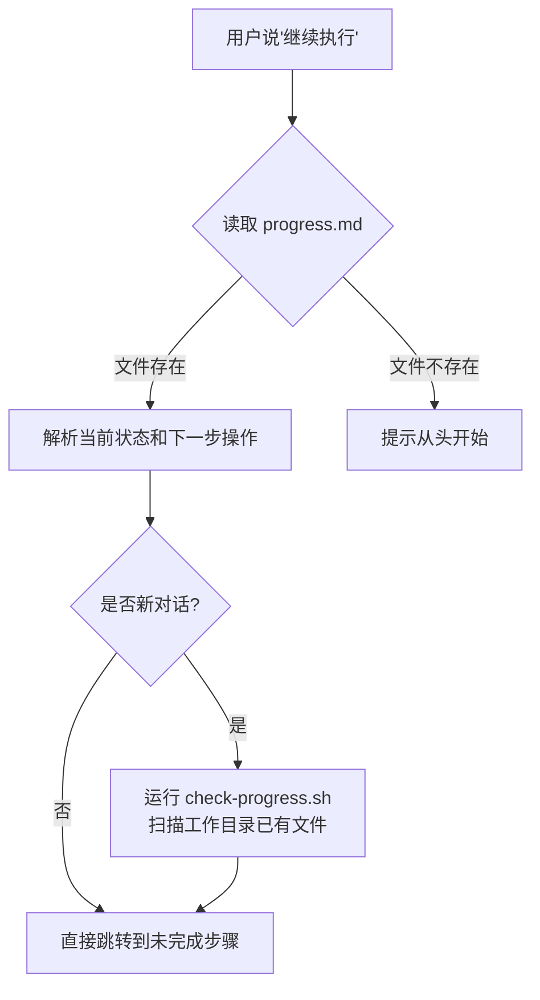
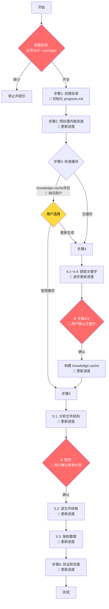

# react2kuikly 方案 — 进度记录与关键节点存档询问设计分析

---

## 一、设计背景

### 1.1 核心问题：AI Agent 对话的"失忆"和"失控"

react2kuikly 是一个 **6 步、多子步骤的复杂代码转换流程**（步骤1→步骤2→步骤3→步骤4(4.1~4.5)→步骤5(5.1~5.3)→步骤6(6.1~6.2)），单次转换可能涉及大量文件和长时间执行。这导致两个关键问题：

| 问题 | 描述 |
|------|------|
| **对话中断导致进度丢失** | AI Agent 的上下文窗口有限，长流程中对话可能因 token 超限、网络中断、用户主动关闭等原因被截断，此时所有中间状态（已完成哪些步骤、中间产物在哪里）全部丢失 |
| **自动化流程缺乏人工把控点** | 整个转换流程涉及多个决策点（关键字是否准确、转换计划是否合理），如果 Agent 全程自动执行，错误会被层层传递和放大，到最终验证阶段才暴露，返工成本极高 |

### 1.2 业务特点驱动设计

- **流程长、步骤多**：6 个主步骤 + 10+ 子步骤，单次完整执行的 token 消耗巨大
- **中间产物有复用价值**：关键字缓存 (`project-keywords.md`) 和知识库缓存 (`knowledge-cache.md`) 构建成本高（需要大量搜索和合并），重复生成浪费严重
- **决策点需要人工判断**：关键字提取是否准确、转换计划是否合理，这些 Agent 无法完全自行判断

---

## 二、设计方案

整体设计分为两套互补的机制：**进度记录系统** 和 **关键节点存档询问机制**。

### 2.1 进度记录系统

#### 2.1.1 核心数据结构：`progress.md`

每个页面转换任务有一个独立的进度文件 `react2kuikly/[页面名]/cache/progress.md`，采用 **Markdown 格式**（而非 JSON/YAML），设计考量是让 AI Agent 能直接阅读理解：

```markdown
# 页面转换进度跟踪

**页面名称**: HomePage  
**输出目录**: react2kuikly/HomePage/working  
**开始时间**: Mon Feb 17 20:00:00 CST 2026  
**当前状态**: 步骤 4.5 已完成  

## 进度记录

### ✅ 已完成步骤
- [x] 步骤 1: 创建目录结构
- [x] 步骤 2: 预处理 - 提取内联资源
...

### 📋 待完成步骤
- [ ] 步骤 5: 生成 Kuikly 代码

## 下一步操作
继续执行步骤5：生成 Kuikly 代码
```

关键字段：
- **当前状态**：一句话描述整体进度
- **最后更新**：时间戳，便于判断是否为过期任务
- **Checkbox 列表**：`[x]`/`[ ]` 标记每步完成状态，支持嵌套子步骤
- **下一步操作**：明确指示 Agent 应该执行什么

#### 2.1.2 进度写入：`update-progress.sh`

每个步骤完成后，通过统一脚本写入进度：

```bash
bash skill/scripts/update-progress.sh \
  --pageName "$PAGE_NAME" \
  --step "4.5" \
  --status "completed" \
  --nextAction "继续执行步骤5：生成 Kuikly 代码"
```

脚本内部使用 `sed` + `awk` 操作 Markdown 文件，支持：
- 将 `[ ]` 更新为 `[x]`
- 更新"当前状态"字段
- 更新"最后更新"时间戳
- 替换"下一步操作"段落内容
- 兼容 macOS/Linux 的 sed 差异

#### 2.1.3 进度读取与恢复：`check-progress.sh` + 恢复机制

当用户说"继续执行"时，触发恢复流程：



新对话恢复时，`check-progress.sh` 还会扫描工作目录中已有的 `.kt` 文件列表，帮助 Agent 建立文件上下文。

### 2.2 关键节点存档询问机制

整个流程中设计了 **3 个阻塞询问点** 和 **3 个非阻塞缓存复用点**：

#### 阻塞询问点（必须等待用户确认）

| 节点 | 位置 | 询问内容 | 设计目的 |
|------|------|---------|---------|
| **关键字确认** | 步骤 4.5 构建知识库前 | 展示提取的组件关键字和业务关键字，等用户确认 | 关键字决定后续知识库内容，错误关键字 → 错误知识 → 错误代码，此处纠错成本最低 |
| **转换计划确认** | 步骤 5.1 完成后 | 展示转换顺序、输出文件名、不转换文件列表 | 文件拆分和转换顺序直接影响代码质量，用户可判断架构合理性 |
| **前置校验** | 流程开始前 | 检查用户是否指定了业务 Skill 和目标 package | 缺少必要参数直接停止，避免无效执行 |

#### 非阻塞缓存复用点（提示用户选择跳过或重新生成）

| 节点 | 位置 | 缓存文件 | 行为 |
|------|------|---------|------|
| **知识缓存检查** | 步骤 3 | `knowledge-cache.md` | 存在 → 可直接跳到步骤 5；不存在 → 继续步骤 4 |
| **关键字缓存检查** | 步骤 4 开始 | `project-keywords.md` | 存在 → 可跳过 4.1~4.3 直接到 4.4 |
| **分析报告缓存** | 步骤 5.1 | `analysis-report.md` + `conversion-plan.md` | 存在 → 可直接跳到 5.2 |

#### 完整的关键节点流程图



---

## 三、收益分析

### 3.1 进度记录系统的收益

| 收益 | 说明 |
|------|------|
| **跨对话断点续传** | 对话中断后，新对话中读取 `progress.md` 即可从上次中断点继续，无需从头重来，节省 50%~80% 的 token 和时间 |
| **中间产物缓存复用** | `knowledge-cache.md` 构建需要大量 MCP 调用和知识合并（通常消耗数千 token），缓存后可在多次转换尝试间复用 |
| **可观测性** | 用户随时可查看 `progress.md` 了解当前进度，不必依赖 AI 上下文记忆 |
| **独立页面隔离** | 每个页面有独立的 cache 目录和进度文件，多页面并行转换互不干扰 |

### 3.2 关键节点存档询问的收益

| 收益 | 说明 |
|------|------|
| **错误前置拦截** | 关键字确认（步骤4.5）和转换计划确认（步骤5.1后）是两个"错误放大器"之前的卡口——关键字错误会导致知识库内容错误进而导致生成代码错误，转换计划错误会导致文件结构和依赖关系混乱 |
| **降低返工成本** | 如果在步骤 6 验证阶段才发现关键字遗漏，需要回退到步骤 4 重做，浪费已消耗的所有步骤 5 的 token；而在步骤 4.5 拦截则零浪费 |
| **用户控制感** | 用户可以在关键决策点介入调整（增减关键字、修改转换计划），而非被动接受 Agent 的全自动结果 |
| **灵活跳过** | 缓存复用点允许用户选择跳过已完成步骤，在迭代调优场景下（如只想重做代码生成、保留知识库）极其高效 |

### 3.3 综合收益量化估算

| 场景 | 无进度系统 | 有进度系统 | 节省 |
|------|-----------|-----------|------|
| 对话中断后恢复 | 从步骤1重新开始 | 从中断步骤继续 | 50%~80% token |
| 重新调整转换计划 | 重建知识库+重新分析 | 跳过步骤1~4，直接修改计划 | 60%~70% token |
| 关键字遗漏修复 | 步骤6发现后回退到步骤4 | 步骤4.5确认时发现并修正 | 避免步骤5全量返工 |
| 多次迭代优化代码 | 每次从头执行 | 复用 knowledge-cache，只重做步骤5~6 | 40%~60% token |

---

## 四、总结

react2kuikly 的进度记录和关键节点存档询问是一套 **面向 AI Agent 长流程任务的"断点续传 + 人工卡口"机制**：

- **进度记录**解决的是"状态持久化"问题——让对话无状态的 AI Agent 具备跨会话的任务记忆能力
- **关键节点询问**解决的是"决策质量控制"问题——在错误传播链的关键节点设置人工卡口，以最低成本拦截错误

两者配合，使得一个原本需要"一气呵成"的复杂转换流程，变成了可暂停、可恢复、可分段迭代的可控流程。
